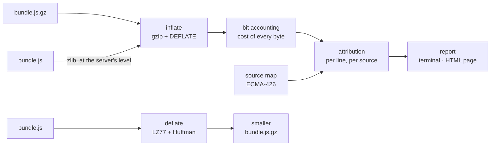

# Architecture

## The product

MAXWELL reads in one direction and writes in the other. Both directions sit behind a single
command line: `report`, `compress` and `decompress`.

## Around it

The command line is defined once:
`--help`, the man page, the completions, etc. are generated from that definition.
Every result is checked against independent implementations:
zlib, `decompress` and the system `gzip`.

MAXWELL is evaluated and released on **Linux x86-64**, and developed on macOS (arm64).

## The role of each technology

| Technology | Role |
|---|---|
| OxCaml | Jane Street's branch of OCaml. |
| dune | OCaml build tool; the Makefile delegates to it. |
| Nix | The root of the toolchain. |
| cmdliner | OCaml dependency that generate documentation based on the command line. |
| grace | OCaml dependcy that renders error messages. |
| camlzip | OCaml dependcy that binds zlib, to compare againt. |
| decompress, zlib, `gzip` | The oracles: what MAXWELL must agree with. |
| Starlight | The documentation site, under `site/`. |
| Jujutsu (`jj`) | Version control. |
